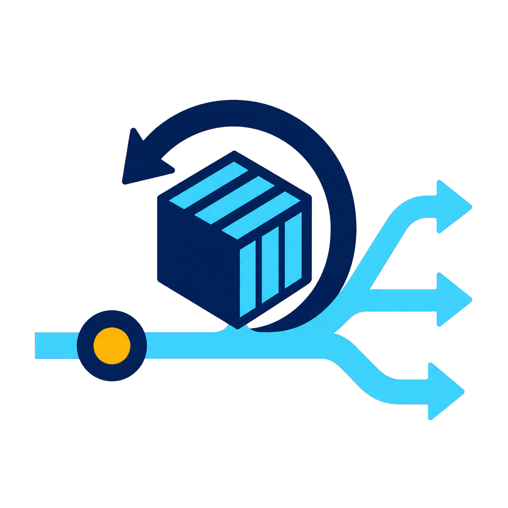

# TimeTravelContainer



TimeTravelContainer (TTC) is a rootless Linux container runtime with **live
forking** support. A fork turns one running container into two or more
independent branches with the same uninterrupted processes, filesystem, and
supported OS resources, including internal network sockets. This lets an LLM
agent associate its token context with an equally forkable sandbox context,
enabling time-traveling retrospection and parallel subagent exploration.

Powered by [gVisor](https://github.com/google/gvisor)'s userspace Linux kernel,
TTC provides this flexibility without hardware virtualization on a Linux host.
Unlike microVM-based platforms such as
[CubeSandbox](https://github.com/TencentCloud/CubeSandbox),
[forkd](https://github.com/deeplethe/forkd), and
[AgentENV](https://github.com/kvcache-ai/AgentENV), TTC does **not** require
KVM, Linux kernel patches, root privileges, or special kernel modules. It runs
rootlessly on Linux 3.17+ and can itself run inside another sandbox, such as a
Docker container, bubblewrap, or a virtual machine.
Apart from Linux hosts, TTC also runs on Apple Silicon Macs (natively)
and Windows (through WSL 2), providing a live forking Linux runtime for them.
This makes TTC a portable foundation for agent harnesses.


The same primitive supports speculative tool use, parallel coding attempts,
integration testing, and debugging—without replaying expensive environment
setup. Moreover, thanks to its portability, TTC might make it practical to
collect branched agent trajectories across diverse real-world tasks directly
on edge devices. Such trajectories could probably help in the development
of continuously improving agentic models that learn from interactions over time.

TTC provides basic isolation and cross-node scaling, but is not intended to be
a complete agent guardrail. During inference, it can run inside a guardrail
such as [OpenShell](https://github.com/NVIDIA/OpenShell); during training, it
can run beneath a large-scale environment orchestrator such as
[NeMo Gym](https://github.com/NVIDIA-NeMo/gym).

TTC is designed for efficiency. Memory and writable storage are
**copy-on-write** (CoW) by default:

- **Fork:** branches share 4 KiB memory pages and files until one writes to
  them. Sharing is transparent and all branches continue independently.
- **Pause/resume:** pause a branch to save CPU while keeping its memory
  resident for a fast resume.
- **Dehydrate/rehydrate:** dehydrate a branch to free its CPU and memory, then
  rehydrate it later with its processes and CoW relationships intact.
- **Remote fork/migration:** fork a branch to another TTC node and start it
  without first transferring all of its memory or filesystem. Missing 1 MiB
  memory chunks and whole files are fetched on demand from the fenced source
  or shared storage; target writes are always node-local.

TTC is an extensible platform in which you can add your own abstractions of
physical hardware, such as a GPU, and define their forking semantics.
As built-in examples, TTC supports
in-container Vulkan graphics acceleration and CUDA GPGPU, which allows booting
a forkable, graphics-accelerated [Android](https://github.com/remote-android/redroid-doc)
or running [llama.cpp](https://github.com/ggml-org/llama.cpp) (Vulkan and CUDA
backends).

## Get Started

**You can download the prebuilt binaries for your OS and CPU in [Releases](https://github.com/NVlabs/TimeTravelContainer/releases)**
(automatic daily builds).

TTC is delivered as two binaries. `ttc` is the CLI client and `ttcd` is
the server daemon. They have no runtime dependencies and can be extracted
to anywhere in your `PATH`; always use a `ttc` and `ttcd` from the same
release. On macOS, a zip that a browser downloads is quarantined: run
`xattr -d com.apple.quarantine` on it before extracting it.

```console
$ export TTC_ROOT="$HOME/.local/share/ttc"
$ ttc daemon start
ttcd started
$ ttc run -itd --network=ttc --nat -v /home:/home:ro \
    --name myapp ubuntu:26.04
$ ttc ps -a
CONTAINER  BRANCH  IMAGE         STATE    CREATED    PARENT
myapp      main    ubuntu:26.04  running  1 day ago  -
```

Environment variable `TTC_ROOT` (and `TTC_LOCAL_ROOT` for distributed TTC)
specifies the directory where TTC stores its data and control socket.
Different directories run independent TTC daemon instances.
A daemon by default runs within an OS sandbox (a user namespace on Linux, and
Seatbelt on macOS). That requirement can be waived with
`--unsafe-no-host-isolation` when starting the daemon, which is necessary when
TTC runs inside another sandbox that forbids user namespaces or, on macOS,
applies its own Seatbelt profile.

TTC works by intercepting system calls from guest processes and interpreting
them in a virtualized userspace Linux kernel. On Linux, `ttc daemon start
--platform=systrap` (the default) uses seccomp to achieve this, whereas
`--platform=kvm` uses hardware virtualization. The macOS build's platform is
a native `hvf` backend (requires Apple Silicon and macOS 15.0+) so you can run
TTC directly on Macs and get a Linux shell.
While it uses virtualization (Hypervisor.framework), it does not boot a Linux
VM. Instead, TTC runs itself as the guest-facing kernel inside the hypervisor.

## Usage
`ttc` uses familiar Docker-style commands and pulls standard OCI images
directly from Docker Hub and other registries. TTC adds branch-aware commands
such as `fork`, `pause`, `resume`, `dehydrate`, and `rehydrate`.

Type `ttc --help` or `ttc <subcommand> --help` for complete command usage.
Existing branches are always addressed as `CONTAINER@BRANCH`; `main` is an
ordinary branch and can be forked or removed like any other.

```sh
# Start a prepared environment and fork two possible futures.
ttc run -dit --name agent --network=ttc --nat ubuntu:26.04 bash
ttc exec agent@main sh -lc 'apt-get update && apt-get install -y git'
ttc fork agent@main approach-a approach-b

# Work in each branch and inspect the branch tree.
ttc exec -it agent@approach-a bash
ttc exec -it agent@approach-b bash
ttc ls --tree

# Suspend cheaply, or release memory for longer idle periods.
ttc pause agent@approach-a
ttc resume agent@approach-a
ttc quarantine agent@approach-a
ttc unquarantine agent@approach-a
ttc dehydrate agent@approach-b
ttc cp agent@approach-b:/workspace/result.patch ./result.patch
ttc rehydrate agent@approach-b

# Remove one branch without affecting its peers.
ttc rm -f agent@approach-a
```

Common workflows include:

| Task | Command |
| --- | --- |
| Manage images | `ttc pull`, `ttc images`, `ttc load`, `ttc save`, `ttc commit` |
| Run and inspect | `ttc run`, `ttc ps`, `ttc inspect`, `ttc top` |
| Interact | `ttc exec`, `ttc attach`, `ttc logs`, `ttc cp` |
| Manage branches | `ttc fork`, `ttc pause`, `ttc resume`, `ttc rm` |
| Persist live state | `ttc dehydrate`, `ttc rehydrate`, `ttc checkpoint`, `ttc restore` |
| Inspect CoW state | `ttc stats`, `ttc diff`, `ttc tty stat` |
| Manage networking | `ttc quarantine`, `ttc unquarantine`, `ttc port publish`, `ttc port ls`, `ttc port unpublish` |
| Manage storage | `ttc volume create`, `ttc volume ls`, `ttc volume rm` |

During `ttc run` or `ttc create`, a container family gets access to specific
emulated hardware. For example, `--network=ttc` gives it a virtual network
card, `--gfx` gives it a virtual Vulkan GPU, and `--nvproxy` gives it the
host's NVIDIA GPUs for CUDA (on Linux). Most options are compatible with live
forks; `--gfx-fork` and `--nvproxy-fork` choose what a fork does with a GPU in
use, and `--waive-live-fork` gives up live forking to enable more options.

Agent harnesses and other programs are recommended to drive TTC through the
same CLI, reading its `--json` output; see
[Driving TTC from programs](g3doc/user_guide/timetravelcontainer.md#driving-ttc-from-programs).

The [end-user guide](g3doc/user_guide/timetravelcontainer.md) covers daemon
operation, networking, volumes, host mounts, checkpoints, remote forks, shell
completion, and recovery in detail. See also the
[current limitations](g3doc/user_guide/ttc_limitations.md).

## Development

### Build Locally

The standard build uses Docker only as a reproducible build environment:

```sh
mkdir -p bin
make copy TARGETS="runsc/ttc runsc/ttcd" DESTINATION="$PWD/bin"
```

The resulting `bin/ttc` and `bin/ttcd` files can be run in place or copied to
any directory in `PATH`. A native Bazel build is also available:

```sh
bazel build //runsc/ttc:ttc //runsc/ttcd:ttcd
```

See the [end-user guide](g3doc/user_guide/timetravelcontainer.md#compile) for
native build prerequisites and installation options.

### Testing

Run the focused TTC unit and integration tests with:

```sh
make test TARGETS="//runsc/ttc/cmd:cmd_test //runsc/boot:boot_test \
  //pkg/sentry/mm:mm_test //pkg/ttcvolume:ttcvolume_test"
```

The [end-to-end test guide](runsc/ttc/test/README.md) covers public images,
networking, interactive sessions, filesystems, live fork, dehydration,
recovery, and nested execution.

### Development Docs

- [Snapshot-graph storage refactor plan](g3doc/proposals/ttc_snapshot_graph_refactor.md)
- [Harness feature tracker and stress-test policy](g3doc/development/ttc_harness_features.md)
- [Client/daemon boundary and size audit](g3doc/development/ttc_client_boundary.md)
- [Live-fork design](g3doc/proposals/timetravel_live_fork.md)
- [Branch state machine](g3doc/ttc_state_machine.md)
- [macOS Hypervisor.framework platform](g3doc/proposals/hvf_full_sentry.md)
- [GPU devices: `--gfx` and `--nvproxy`](g3doc/proposals/ttc_gpu_gfx_nvproxy.md)
- [Venus GPU renderer](g3doc/proposals/ttc_venus_renderer.md)
- [Security, performance, and compatibility audit (August 2026)](g3doc/proposals/timetravel_ttc_audit.md)
- [Upstream gVisor documentation](https://gvisor.dev/docs/)

## Contributing

Commits must be signed off under the Developer Certificate of Origin; see
[CONTRIBUTING.md](CONTRIBUTING.md).

## License

TimeTravelContainer is licensed under the [Apache License 2.0](LICENSE). It is
a modified version of [gVisor](https://github.com/google/gvisor).
[THIRD_PARTY_NOTICES.md](THIRD_PARTY_NOTICES.md) names all
third-party components TimeTravelContainer uses, with their respective licenses.

The following subdirectories retain separate BSD-3-Clause licenses for code
from The Go Authors:

- `pkg/safecopy`: [BSD-3-Clause license](pkg/safecopy/LICENSE).
- `pkg/sync`: [BSD-3-Clause license](pkg/sync/LICENSE).
- `pkg/sentry/time`: [BSD-3-Clause license](pkg/sentry/time/LICENSE).

## Citation

``` bibtex
@article{TTC,
  title         = "{TimeTravelContainer}: A Live Forking Sandbox for Stateful
                   Agent Exploration",
  author        = "Guo, Zizheng and Zhang, Yanqing and Pinckney, Nathaniel and
                   Yu, Cunxi and Khailany, Brucek",
  month         =  nov,
  year          =  2026,
  archivePrefix = "arXiv",
  primaryClass  = "cs.OS",
  eprint        = "2611.32255"
}
```
