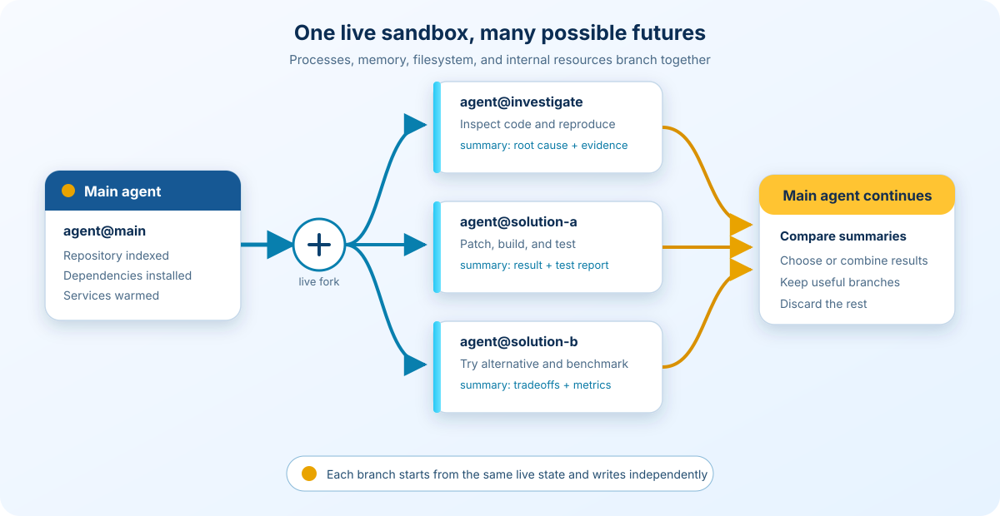

# TimeTravelContainer


TimeTravelContainer (TTC) is a rootless Linux container runtime with **live
forking** support. A fork turns one running container into two or more
independent branches with the same uninterrupted processes, filesystem, and
supported OS resources, including internal network sockets. This lets an LLM
agent associate its token context with an equally forkable sandbox context,
enabling time-traveling retrospection and parallel subagent exploration.

Powered by [gVisor](https://github.com/google/gvisor)'s userspace Linux kernel,
TTC provides this flexibility without booting a guest Linux kernel. On Linux,
it does not require hardware virtualization. The native Apple-Silicon backend
uses Hypervisor.framework to run application contexts and a small EL1 MMU
monitor, while the Sentry remains the Linux kernel implementation. Unlike
microVM-based platforms such as
[CubeSandbox](https://github.com/TencentCloud/CubeSandbox),
[forkd](https://github.com/deeplethe/forkd), and
[AgentENV](https://github.com/kvcache-ai/AgentENV), TTC does **not** require
KVM, Linux kernel patches, root privileges, or special kernel modules. It runs
rootlessly on Linux 3.17+ and can itself run inside another sandbox, such as a
Docker container, bubblewrap, or a virtual machine. This makes TTC a portable
foundation for agent harnesses.



The same primitive supports speculative tool use, parallel coding attempts,
integration testing, and debugging—without replaying expensive environment
setup.

TTC provides basic isolation and cross-node scaling, but is not intended to be
a complete agent guardrail. During inference, it can run inside a guardrail
such as [OpenShell](https://github.com/NVIDIA/OpenShell); during training, it
can run beneath a large-scale environment orchestrator such as
[NeMo Gym](https://github.com/NVIDIA-NeMo/gym).

TTC is designed for efficiency. Memory and writable storage are
**copy-on-write** (CoW) by default:

- **Fork:** branches share 4 KiB memory pages and files until one writes to
  them. Sharing is transparent and all branches continue independently.
- **Pause/resume:** pause a branch to save CPU while keeping its memory
  resident for a fast resume.
- **Dehydrate/rehydrate:** dehydrate a branch to free its CPU and memory, then
  rehydrate it later with its processes and CoW relationships intact.
- **Remote fork/migration:** fork a branch to another TTC node and start it
  without first transferring all of its memory or filesystem. Missing 1 MiB
  memory chunks and whole files are fetched on demand from the fenced source
  or shared storage; target writes are always node-local.

## Get Started

TTC is delivered as two binaries. `ttc` is the CLI client and `ttcd` is the
server daemon; `ttcd` also contains the re-executed `runsc` runtime entry point.

\<Download instruction TBA, do not remove this yet\>

```console
$ export TTC_ROOT="$HOME/.local/share/ttc"
$ ttc daemon start
ttcd started
$ ttc run -itd --network=ttc --nat -v /home:/home:ro \
    --name myapp ubuntu:26.04
$ ttc ps -a
CONTAINER  BRANCH  IMAGE         STATE    CREATED    PARENT
myapp      main    ubuntu:26.04  running  1 day ago  -
```

`daemon start` always launches the `ttcd` installed beside `ttc`, and requires
both binaries to come from the same build; `ttc` does not contain a fallback
daemon entry point. If it cannot be found or executed, startup fails
immediately without creating a daemon socket.

### Native Apple-Silicon macOS

The native macOS backend requires Apple Silicon and macOS 15.0 or newer. It
uses baseline Hypervisor.framework APIs, 4 KiB Linux pages over 16 KiB host
allocation slabs, and does not boot a Linux VM. This first backend is a trusted
workload mode: it deliberately omits Linux host namespaces, seccomp, and
cgroups, and therefore makes no macOS host-security-boundary claim.

Use the installer to build, copy, and ad-hoc sign `ttcd` at its final path. It
defaults to `../bin`; pass a destination directory as its first argument and
set `BAZEL` when Bazel is not in `PATH`:

```sh
BAZEL=/path/to/bazel tools/ttc/install_macos.sh ~/projects/ttc-macos/bin
```

For a manual installation, copy the runtime first and then sign the installed
`ttcd`. A plain Bazel output has only a linker signature and cannot use
Hypervisor.framework. Signing before a copy is insufficient on macOS versions
that validate the installed inode independently:

```sh
bazel build //runsc/ttc:ttc //runsc/ttcd:ttcd
mkdir -p bin
cp bazel-bin/runsc/ttc/ttc_/ttc bin/ttc
cp bazel-bin/runsc/ttcd/ttcd_/ttcd bin/ttcd
codesign --force --sign - \
  --entitlements runsc/hvf.entitlements \
  bin/ttcd
```

Start the daemon only with the explicit trusted-mode opt-in. `ttcd` checks
its own Hypervisor.framework entitlement at startup:

```sh
export TTC_ROOT="$HOME/.local/share/ttc"
bin/ttc daemon start --unsafe-no-host-isolation
```

TTC_ROOT must name a new-format data root; data roots created by earlier TTC
builds are not migrated.

For OCI-runtime integration, invoke the embedded runtime as `ttcd runsc ...`,
or install a `runsc` symlink to `ttcd`; argv-based re-execution preserves the
same runtime mode. The Bazel configuration sets the runtime deployment target
to macOS 15.0, and the entitlement file grants
`com.apple.security.hypervisor`.

`ttc` uses familiar Docker-style commands and pulls standard OCI images
directly from Docker Hub and other registries. TTC adds branch-aware commands
such as `fork`, `pause`, `resume`, `dehydrate`, and `rehydrate`.

## Usage

Type `ttc --help` or `ttc <subcommand> --help` for complete command usage.
Existing branches are always addressed as `CONTAINER@BRANCH`; `main` is an
ordinary branch and can be forked or removed like any other.

```sh
# Start a prepared environment and fork two possible futures.
ttc run -dit --name agent ubuntu:26.04 bash
ttc exec agent@main sh -lc 'apt-get update && apt-get install -y git'
ttc fork agent@main approach-a approach-b

# Work in each branch and inspect the branch tree.
ttc exec -it agent@approach-a bash
ttc exec -it agent@approach-b bash
ttc ls --tree

# Suspend cheaply, or release memory for longer idle periods.
ttc pause agent@approach-a
ttc resume agent@approach-a
ttc quarantine agent@approach-a
ttc unquarantine agent@approach-a
ttc dehydrate agent@approach-b
ttc cp agent@approach-b:/workspace/result.patch ./result.patch
ttc rehydrate agent@approach-b

# Remove one branch without affecting its peers.
ttc rm -f agent@approach-a
```

Common workflows include:

| Task | Command |
| --- | --- |
| Manage images | `ttc pull`, `ttc images`, `ttc load`, `ttc save`, `ttc commit` |
| Run and inspect | `ttc run`, `ttc ps`, `ttc inspect`, `ttc top` |
| Interact | `ttc exec`, `ttc attach`, `ttc logs`, `ttc cp` |
| Manage branches | `ttc fork`, `ttc pause`, `ttc resume`, `ttc rm` |
| Persist live state | `ttc dehydrate`, `ttc rehydrate`, `ttc checkpoint`, `ttc restore` |
| Inspect CoW state | `ttc stats`, `ttc diff`, `ttc tty stat` |
| Manage networking | `ttc quarantine`, `ttc unquarantine`, `ttc port publish`, `ttc port ls`, `ttc port unpublish` |
| Manage storage | `ttc volume create`, `ttc volume ls`, `ttc volume rm` |

The [end-user guide](g3doc/user_guide/timetravelcontainer.md) covers daemon
operation, networking, volumes, host mounts, checkpoints, remote forks, shell
completion, and recovery in detail.

## SDKs and agent integration

The `ttcx` SDKs talk directly to a running `ttcd`; applications do not need to
spawn or parse the `ttc` CLI. Each SDK returns structured stdout, stderr, and
exit status and provides helpers for run, named exec sessions, batch or remote
fork, pause/resume, dehydration, commit, resource accounting, filesystem diff,
copy, checkpoint/restore, lifecycle control, and removal.

- [Python](sdk/python/README.md)
- [TypeScript](sdk/typescript/README.md)
- [Rust](sdk/rust/README.md)
- [MCP server](sdk/mcp/README.md) for coding agents and MCP clients
- [Local daemon protocol](sdk/PROTOCOL.md) for additional language bindings

For example, Python agents can branch a sandbox directly:

```python
from ttcx import Client

ttc = Client()
ttc.fork("agent@main", "candidate").check()
result = ttc.exec("agent@candidate", ["sh", "-lc", "make test"])
result.check()
print(result.stdout_text())
```

## Features and Requirements

TTC includes:

- Direct OCI image pulls and Docker-style image, container, volume, log, exec,
  attach, copy, commit, port-forwarding, and lifecycle commands.
- Full-branch pause, resume, fork, dehydration, rehydration, checkpoint, and
  restore.
- Per-branch CoW resource accounting, metadata-based filesystem diffs, named
  reattachable exec sessions, and terminal-observation APIs for agent harnesses.
- Stable JSON observability for placement, immutable snapshot and root IDs,
  publication errors, volatile dependencies, graph/GC counts, and image-cache
  progress.
- Copy-on-write process memory, tmpfs, internal IPC and sockets, and persistent
  writable filesystems.
- Rootless userspace networking with isolated virtual NICs, outbound NAT,
  published TCP ports, and configurable IP and MAC addresses.
- Read-only host mounts, branch-private writable views of host paths, tmpfs,
  and managed persistent volumes.
- In-sandbox FUSE filesystems, including executable and writable shared
  mappings; AppImages, the FUSE daemon, mount state, and cached pages remain
  forkable.
- Optional multi-node live fork over a trusted private network, with an
  optional shared token, a shared TTC data root, and a page-transfer network.
  Elastic mode adds dynamic node discovery, transparent command routing,
  branch migration, policy-driven node shutdown, and pressure-aware placement.

Unlike [CRIU](https://github.com/checkpoint-restore/criu) or a
[Firecracker](https://github.com/firecracker-microvm/firecracker) microVM, a
TTC live fork does not save the container's memory to a checkpoint first.
Durable storage is used only for explicitly requested operations such as
dehydration and checkpointing, or when a remote branch must no longer depend
on a source node. Dehydration stores branch-reachable memory in compact 1 MiB
records while retaining independent 4 KiB page identities. Immutable pages
already represented in the snapshot graph are referenced again rather than
written a second time.

Live-fork eligibility is a lifetime property of a container family. Families
are eligible by default, and TTC rejects incompatible features when they are
requested rather than allowing a running workload to become unexpectedly
unforkable. A feature whose state is deliberately outside the Sentry, such as
host networking, can be selected only together with `--waive-live-fork`; every
fork of that family then fails predictably. Guest-created, Sentry-managed
resources—including network namespaces, virtual interfaces, routes, iptables,
and internal sockets—remain forkable.

Host requirements are deliberately small:

- Linux 3.17 or newer on x86-64 or ARM64. Linux 4.14.77+ is recommended for
  full network performance.
- (Optional) An unprivileged user namespace for normal rootless isolation. No
  subordinate UID/GID ranges or `newuidmap` helpers are required. Trusted
  environments that prohibit user namespaces can explicitly use
  `--unsafe-no-host-isolation`.
- A data root on any supported local filesystem. TTC uses reflinks when
  available and otherwise transparently falls back to whole-file copying on
  the first write after a fork.
- (Optional) A delegated cgroup v2 subtree only when hard host CPU or memory
  limits are requested.

`TTC_ROOT` is always explicit. In standalone mode it contains all TTC state.
Cluster nodes use the same shared `TTC_ROOT` and each set a distinct,
node-local `TTC_LOCAL_ROOT` for active runtimes and caches. `TTC_SOCKET` may
override the per-user daemon socket; `--daemon-socket` takes precedence for a
single client invocation. `ttc` owns its help and command grammar locally, so
help, completion, and version output do not depend on a running daemon. For
daemon operations, the official client and daemon builds must match exactly.

## Current Limitations

See [Current Limitations](g3doc/user_guide/ttc_limitations.md).

## Development

### Build Locally

The standard build uses Docker only as a reproducible build environment:

```sh
mkdir -p bin
make copy TARGETS="runsc/ttc runsc/ttcd" DESTINATION="$PWD/bin"
```

The resulting `bin/ttc` and `bin/ttcd` files can be run in place or copied to
any directory in `PATH`. A native Bazel build is also available:

```sh
bazel build //runsc/ttc:ttc //runsc/ttcd:ttcd
```

See the [end-user guide](g3doc/user_guide/timetravelcontainer.md#compile) for
native build prerequisites and installation options.

### Testing

Run the focused TTC unit and integration tests with:

```sh
make test TARGETS="//runsc/ttc/cmd:cmd_test //runsc/boot:boot_test \
  //pkg/sentry/mm:mm_test //pkg/ttcvolume:ttcvolume_test"
```

The [end-to-end test guide](runsc/ttc/test/README.md) covers public images,
networking, interactive sessions, filesystems, live fork, dehydration,
recovery, and nested execution.

### Development Docs

- [Snapshot-graph storage refactor plan](g3doc/proposals/ttc_snapshot_graph_refactor.md)
- [Harness feature tracker and stress-test policy](g3doc/development/ttc_harness_features.md)
- [Client/daemon boundary and size audit](g3doc/development/ttc_client_boundary.md)
- [Live-fork design](g3doc/proposals/timetravel_live_fork.md)
- [Branch state machine](g3doc/ttc_state_machine.md)
- [Distributed live-fork plan](g3doc/proposals/ttc_distributed_live_fork.md)
- [Disk-backed storage design](g3doc/proposals/ttc_disk_backed_volumes.md)
- [Security, performance, and compatibility audit](g3doc/proposals/timetravel_ttc_audit.md)
- [Upstream gVisor documentation](https://gvisor.dev/docs/)

## License

TimeTravelContainer is licensed under the [Apache License 2.0](LICENSE).
